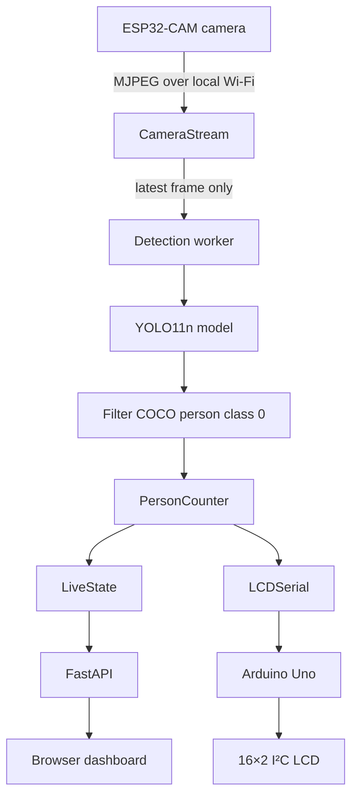
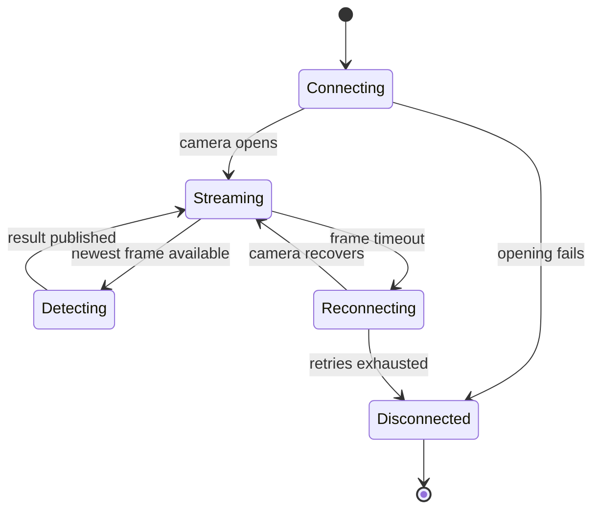
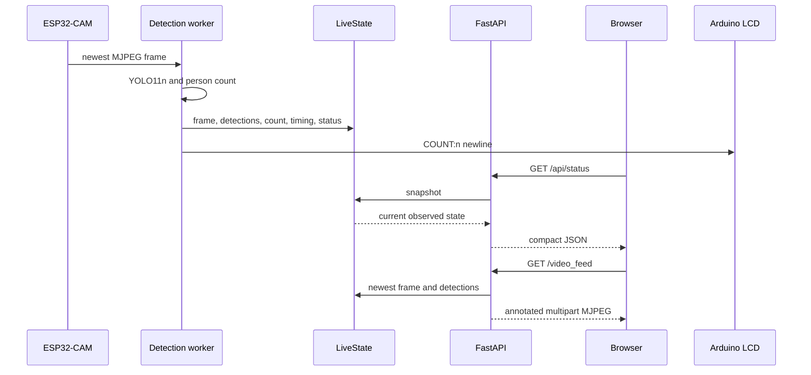

# System Architecture

Sentinel Vision is a local, single-process computer-vision application. It
performs inference on the laptop; the ESP32-CAM only captures and streams video.

## Single source of truth

The detection worker owns one `CameraStream`, one `PersonDetector`, and one
`PersonCounter`. After each accepted detection cycle, it publishes the count,
detections, measurements, and latest frame to `LiveState`.

- The dashboard reads the latest state through FastAPI.
- The dashboard's MJPEG endpoint draws overlays from the same detections.
- `LCDSerial` receives the same accepted `current_count`.
- Browser clients do not trigger model inference, camera reads, or Arduino writes.

This design prevents duplicate YOLO work and prevents a growing frame queue.

## Camera and inference lifecycle

`CameraStream` retains one decoded newest frame. If inference takes longer than
capture, older frames are replaced rather than queued. The count becomes
unavailable when the camera is reconnecting or a detection result becomes stale;
the dashboard does not turn that condition into a count of zero.

## Dashboard data flow

## Important boundaries

- The ESP32-CAM does not run YOLO.
- The Arduino does not decide the human count; it displays the laptop's latest
  accepted value.
- The browser is a presentation layer, not a second detection pipeline.
- No database, cloud service, telemetry, or public internet exposure is required.
