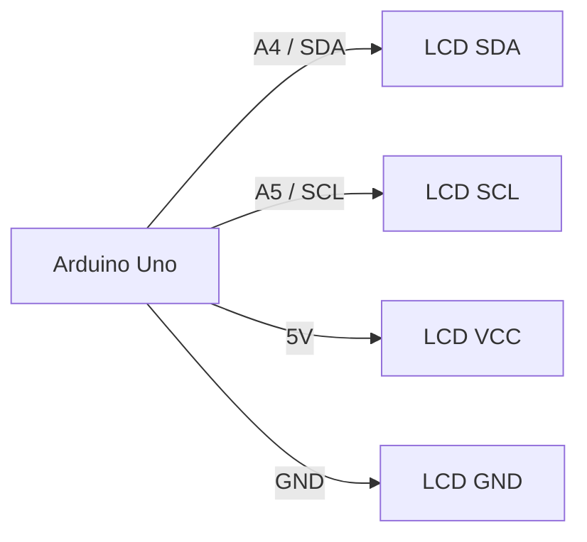

# Hardware and Circuit Guide

## Components

- ESP32-CAM with a supported camera sensor
- Stable regulated power supply for the ESP32-CAM
- Arduino Uno
- 16×2 HD44780-compatible LCD with a PCF8574-style I²C backpack
- USB cable for the Arduino Uno

## System wiring diagram

The ESP32-CAM and Arduino Uno have separate jobs and do not require a direct
data wire between them. The laptop processes video and transfers the current
human count to the Uno over USB.

## Arduino Uno to I²C LCD

| LCD backpack pin | Arduino Uno pin | Purpose |
|---|---|---|
| VCC | 5V | LCD power |
| GND | GND | Common ground |
| SDA | A4 | I²C data |
| SCL | A5 | I²C clock |

The supplied firmware uses `hd44780_I2Cexp`, which detects common I²C backpack
addresses automatically. Do not add a fixed address unless you intentionally
replace that library and understand the hardware.

## ESP32-CAM programming connection

Use a USB-to-UART adapter with 3.3 V logic levels for camera serial pins.

| USB-to-UART adapter | ESP32-CAM |
|---|---|
| TX, 3.3 V logic | U0R / GPIO3 |
| RX, 3.3 V logic | U0T / GPIO1 |
| GND | GND |
| Stable power | 5V input |
| Temporary flashing jumper | GPIO0 to GND while flashing only |

Remove the GPIO0-to-GND jumper after uploading firmware, then reset the camera.
Do not apply 5 V UART logic to the ESP32-CAM data pins. Follow the camera board
documentation for its required power supply current.

## Safety and reliability

- Power down boards before changing wiring.
- Use a stable power source for the camera; weak supplies often cause stream
  resets or Wi-Fi dropouts.
- Close Arduino IDE Serial Monitor before running Python because only one
  program can hold the Arduino serial port at a time.
- The LCD backlight brightness is a separate electrical issue; this project does
  not modify the backpack or add a potentiometer.
